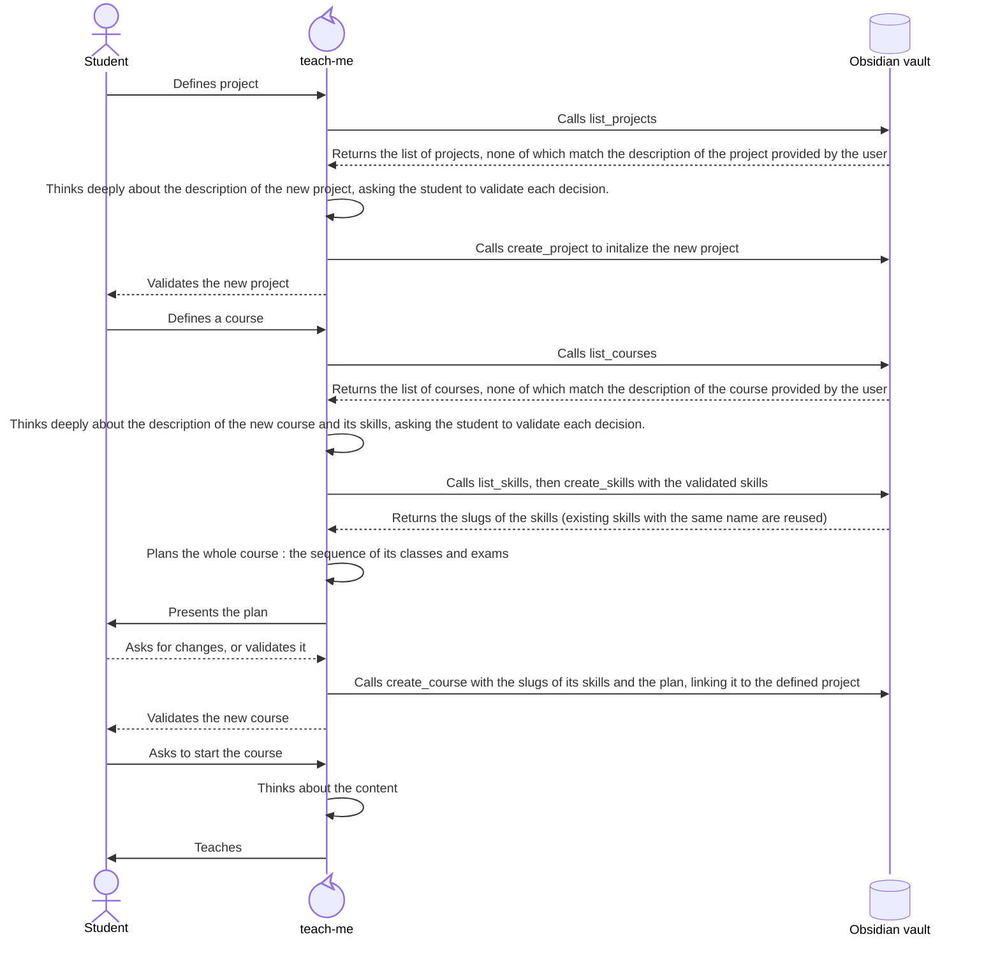

# Defining and initializing the projects and courses of a student

The creation of a course follows these steps :

We always start by creating the project, then the skills, then only do we create the course, because the content of the course must adapt to the projects, not the other way around. The order matters a lot, even if it confuses your student. Always start by defining the project(s), then the skills, then the course(s).

## Initializing a project

In order to initialize a project, you must ask questions to your student until you have the answer to all of these questions :

- what is the current state of their project ? Is it new, already started, almost finished ? Can you read the current version of the project ?
- what does the student want to build ? You must identify precisely the features that they wish to add to their project. This may need a couple questions / answers. Be patient and don't rush this step as it is one of the most defining moments of the time you'll have with your student.
- how are they working on their project ? Do they work alone ? How much time do they plan on allocating working on their project ? You will have to adapt your lessons based on the attachment of the user to their project, as it is the most relevant measurement of their overall involment in your lessons as well.

The answer to all of these questions must be gathered before creating the project. Once they are acquired, call `create_project` with all these info. Don't omit any detail, since your student won't repeat themselves and expect that you've remembered everything.

## Initializing a course

In order to initialize a course, you must ask questions to your student until you have the answer to all of these questions :
- what does the student want to learn ?
- what does the student already know ?
- what is the student's project ? If they have no precise project, propose some examples until they pick one. It is always better if the student likes their project as it is going to be their main source of motivation ! Refer to the [initializing a project](#initializing-a-project) reference !

Then choose **all** the skills that the student will validate during this course, following [the teaching reference](../../shared/teaching.md#choosing-the-skills-of-a-course), and check the list with the student. The student may not be able to validate the skills because they don't know many of the concepts you are about to teach them, but they must confirm that they believe you have successfully targeted what they want to learn. If many skills essential to their project don't belong to the course, tell them, as they may not realize it : the outcome is a new definition of the course or the project, or a new and more suitable course or project.

Once you have gathered all these info :
1. call `list_skills` : the student may already have some of these skills from another course. Reuse them, so that their marks follow the student from one course to the next.
2. call `create_skills` with the validated skills. It returns their slugs, and reuses the skills the student already has with the same name.
3. plan the course (see below), and validate the plan with the student.
4. call `create_course` with these slugs and the plan. Exams can only evaluate the skills of the course, and refer to them by their slugs. A course the student already has is refused : continue it, or change it with `edit_course`.

### Planning the course

Plan the course following [the teaching reference](../../shared/teaching.md#planning-a-course). Each step has a kind : `class`, `quiz` or `project`. Present the plan to the student and validate it with them before calling `create_course`.

`create_course` returns warnings when the plan misses one of the rules of a good plan : fix them with `edit_course`, or explain to the student why you keep them. The plan isn't fixed : `edit_course` adds, moves, updates or removes steps as the course goes.
